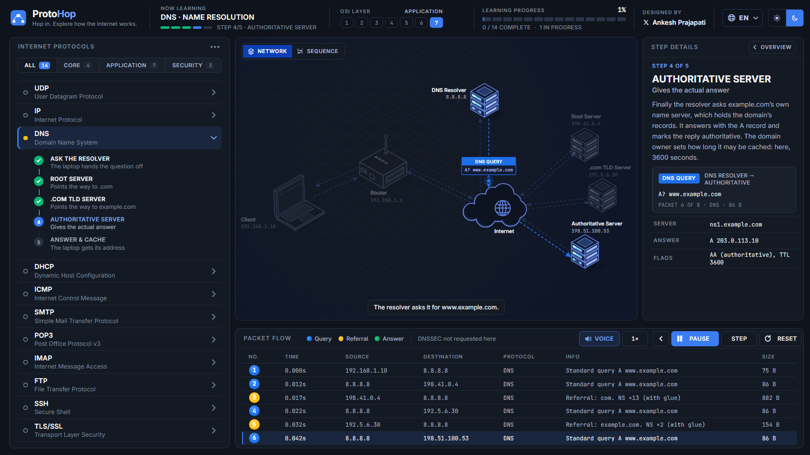
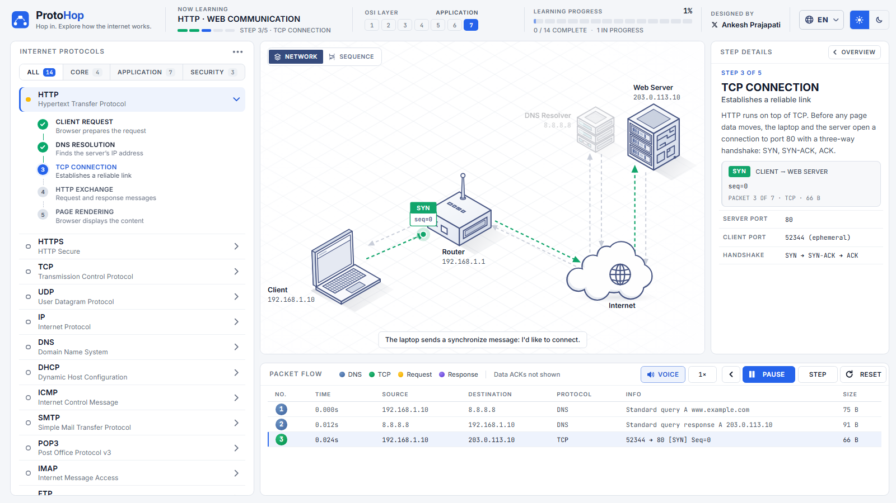
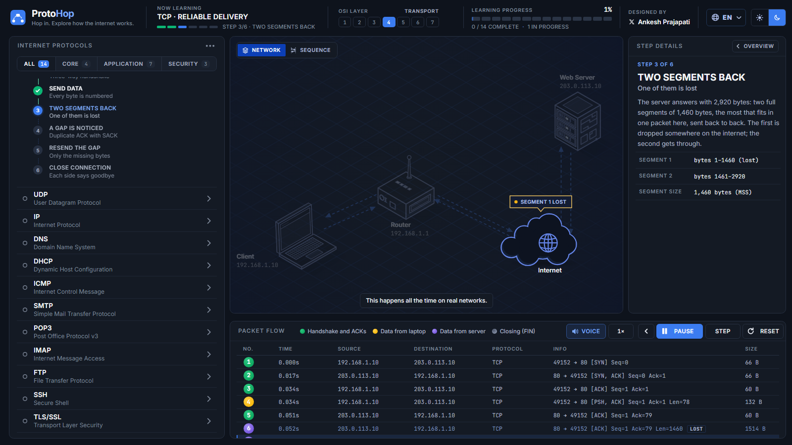

<p align="center">
  
</p>

<h1 align="center">ProtoHop</h1>

<p align="center">
  <strong>Hop in. Explore how the internet works.</strong><br>
  Interactive, narrated lessons on 14 internet protocols, one packet at a time.
</p>

<p align="center">
  
</p>

ProtoHop is an interactive, narrated course on 14 core internet protocols. Each lesson animates real packets moving across a network, decodes them in a packet table, and talks you through what is happening. The animation waits for each explanation, and the part of the network being described is highlighted.

## Screenshots

<table>
  <tr>
    <td width="50%" valign="top">
      
      <p align="center"><sub><b>TCP handshake, light theme.</b> The packet's whole route stays in focus while the voice explains it.</sub></p>
    </td>
    <td width="50%" valign="top">
      
      <p align="center"><sub><b>Packet loss, dark theme.</b> Notes stay on screen until they have been explained.</sub></p>
    </td>
  </tr>
</table>

## Features

- **14 protocol lessons**, from DNS lookups to TLS handshakes, each broken into 5 or 6 steps.
- **Voice explanations synced to the animation.** Every animation event has its own short narration. The animation waits on a point until it has been explained, then continues.
- **Focus highlighting.** While a point is explained, the devices involved stay in focus, the rest of the diagram recedes, and the matching packet row is marked.
- **Live captions** that show the sentence being spoken.
- **Packet flow table** with the time, source, destination, protocol, info and size of every packet. Click a row to inspect it.
- **Network and sequence views** of the same exchange.
- **Playback controls**: play, pause, step one packet at a time, go back, reset, and 0.5× to 2× speed.
- **Progress tracking** across lessons, kept in your browser.
- **Dark and light themes.**
- **No build step and no backend.** It is a static site, so it runs on GitHub Pages as-is.

## Lessons

| Group | Protocols |
| --- | --- |
| Core | IP, TCP, UDP, ICMP |
| Application | HTTP, DNS, DHCP, SMTP, POP3, IMAP, FTP |
| Security | HTTPS, TLS, SSH |

## Using it

1. Pick a protocol in the sidebar. Its overview is read out.
2. Press **PLAY**. Each step animates with its explanation; the lesson waits whenever the voice is still explaining.
3. Use **VOICE** in the packet-flow toolbar to mute or unmute explanations. Pausing the lesson pauses the voice too.
4. Click any step in the sidebar to jump straight to it, or use **STEP** to advance one packet at a time.

Keyboard: `Space` plays or pauses, `←` and `→` move between steps, `Esc` returns to the overview.

> Browsers block sound until you interact with a page, so narration starts after your first click.

## Run locally

Any static file server works. From the project folder:

```bash
python -m http.server 8080
```

Then open <http://localhost:8080>. (Opening `index.html` directly from disk does not work, because browsers block module scripts and audio loading on `file://` URLs.)

## Deploy to GitHub Pages

1. Push this folder to a GitHub repository, with `index.html` at the root.
2. In the repository, open **Settings → Pages**.
3. Under **Build and deployment**, choose **Deploy from a branch**, select your branch (for example `main`) and the `/ (root)` folder, then save.
4. After a minute or two the site is live at `https://<your-username>.github.io/<repository-name>/`.

All paths are relative, so the site works from a repository subfolder URL without changes.

## Project structure

```
index.html                  Page shell, metadata and security policy
assets/
  index-*.js                Lesson engine: protocol data, network diagram, packet simulation
  index-*.css               Base styles and layout
  palette.css               Toned-down colour tokens (generated)
  theme.css                 ProtoHop look: typography, surfaces, components
  audio-narrator.js         Voice-over, captions, highlighting and animation sync
  narration/
    cues.json               Narration script: one entry per animation event
    timings.json            When each sentence starts in each clip (generated)
    *.mp3                   Narration clips (generated)
  fonts/                    Inter and JetBrains Mono (self-hosted)
  favicon.svg
tools/
  build_narration.py        Renders cues.json to MP3 clips and sentence timings
  build_palette.js          Generates palette.css from the base styles
docs/
  screenshot.png
```

## Editing the narration

Narration lives in `assets/narration/cues.json`. Keys follow the lesson structure:

| Key | Played |
| --- | --- |
| `dns-0` | Lesson overview, when the lesson is opened |
| `dns-2-1` | Step 2, animation event 1 (events are numbered from 0 within each step) |
| `dns-done` | Recap, when the lesson finishes |

After editing the text, regenerate the audio (requires Python 3 and an internet connection):

```bash
pip install edge-tts
python tools/build_narration.py           # renders new or missing clips
python tools/build_narration.py --force   # re-renders every clip
```

After re-rendering, increase `NARRATION_VERSION` at the top of `assets/audio-narrator.js` so browsers fetch the new clips instead of cached ones.

Write narration the way it should be spoken. The voice spells out or mispronounces protocol tokens such as SYN, ACK, EHLO or RETR, so describe the action in words ("a synchronize message", "the retrieve command") and leave the technical names to the on-screen packet labels.

The voice and speaking rate are set at the top of `tools/build_narration.py`. Clips use Microsoft's neural text-to-speech through the `edge-tts` package. English uses these recorded clips. Missing clips fall back to the browser's built-in speech.

## Customising the look

- `assets/theme.css` holds the typography, surfaces and component styles. The colour variables at the top (`--bg`, `--panel`, `--ink`, `--nf-accent` and so on) control most of the look in both themes.
- `assets/palette.css` is generated by `node tools/build_palette.js`. It tones down the blue-tinted colours of the base stylesheet while keeping the packet colours (green, amber, violet, teal) that carry meaning.

## How the voice stays in sync

The lesson player calls `window.__peEvent` as each animation event starts, which begins that event's clip and highlights what it involves. After each event it awaits `window.__peGate`, which resolves once the clip has finished. So the animation never runs ahead of the explanation, and quick events that finish talking early flow straight on.

## Credits

Designed and narrated by [Ankesh Prajapati](https://x.com/AnkeshP62316667).

ProtoHop builds on [Protocol Explorer](https://protocol-explorer-alpha.vercel.app/) by Dilum Sanjaya, whose lesson engine, protocol data and network diagrams it uses.
